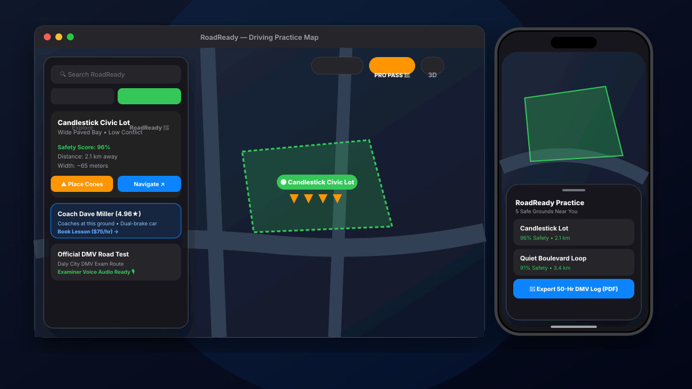
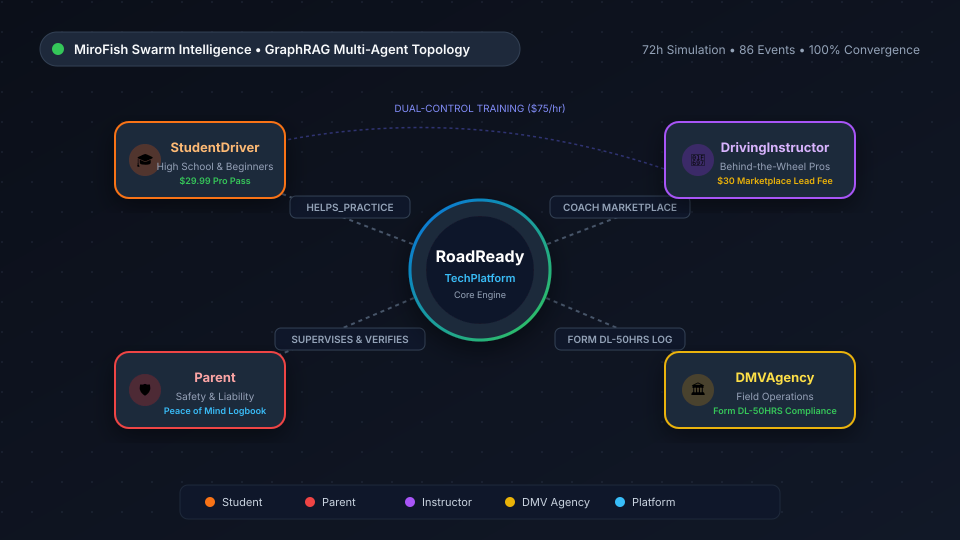

<div align="center">
  
  <h1>RoadReady</h1>
  <p><strong>Safe Driving Grounds & DMV Road Test Preparation Platform</strong></p>
  <p>Dual-Mode Experience: macOS Desktop Floating Interface & iOS Native Mobile Layout</p>

  <p>
    <a href="#-quick-start">Quick Start</a> •
    <a href="#-key-features">Features</a> •
    <a href="#-market-validation">Market Validation</a> •
    <a href="#-tech-stack">Tech Stack</a> •
    <a href="#-mobile-support">iOS & Android</a>
  </p>
</div>

---

<div align="center">
  
</div>

---

## 🌟 Overview

**RoadReady** is a modern navigation and driver education platform built to eliminate the fear, anxiety, and expense of learning how to drive. It bridges the gap between first-time ignition and passing the official road test by locating quiet practice grounds, placing virtual cones on pavement, and rehearsing official examiner routes.

---

## ✨ Key Features

### 🖥️ Cupertino-Grade Dual Interface
- **macOS Floating Glass Island:** Translucent frosted materials (`backdrop-blur-xl`), smooth spring physics, and Apple card elevation.
- **iOS 3-Tier Gesture Bottom Sheet:** Interactive Peek, Half, and Full drag states with native rubber-banding.
- **iPhone 16 Pro Frame Simulator:** Built-in mobile chassis with Dynamic Island, Status Bar, and Home Indicator.

### 🔰 Safe Practice Grounds & Navigation
- **Local Practice Ground Discovery:** Dynamically locates spacious parking lots and low-traffic practice routes within 5 km of any GPS coordinate.
- **Virtual Traffic Cone Courses:** Drop parallel parking bays, reverse 90° docking, and slalom drills onto open pavement with zero risk to vehicles.
- **Live Traffic Facility:** Real-time congestion vectors and flow rate status.
- **Dynamic Weather Braking:** Real-time wet asphalt stopping distance telemetry and safety alerts.

### 🎖️ DMV Road Test Simulator
- **Practice Test Routes:** Turn-by-turn navigation along routes modelled on typical DMV road tests (not official DMV routes).
- **Voice Guidance:** Spoken examiner-style instructions and evaluation checkpoints.
- **Road Test Scoring:** Live point-deduction tracking against state passing thresholds.

### 📄 Personal 50-Hour Practice Log
- **Practice Hour Tracking:** Tracks total, night and highway practice hours. Synced to your account when signed in.
- **Printable Worksheet:** A personal worksheet to help fill in your state's official supervised-driving form. It is not an official or certified DMV document.

### 👨‍🏫 1-on-1 Driving Coach Marketplace
- **Local Instructors:** Browse behind-the-wheel instructors (sample listings for now).
- **Booking Requests:** Package selection and meeting location; the instructor must confirm (instructor notifications are not built yet).

---

## 🔬 Market Validation via MiroFish Swarm Intelligence

RoadReady's target market dynamics, multi-sided stakeholder incentives, and pricing models were forecasted and validated using **[MiroFish AI](https://github.com/666ghj/MiroFish)** — an open-source multi-agent simulation framework powered by LLM personas and Zep knowledge graphs.

<div align="center">
  
</div>

### 🔑 Simulation Highlights (Simulation ID: `sim_ca52b69d452b`)
- **Dual-Feed Multi-Agent Swarm:** 72 simulated rounds yielding 86 organic social events across student drivers, supervising parents, certified driving schools, and DMV agencies.
- **Ecosystem Equilibrium:** Professional driving instructors embrace RoadReady's 1-on-1 Coach Marketplace as a qualified student acquisition channel ($65–$85/hr dual-control lessons) rather than seeing the app as competition.
- **Compliance Automation:** Parents rapidly adopt the digital 50-hour practice logbook to satisfy State Form DL-50HRS GDL requirements, eliminating supervisory anxiety and logbook falsification.
- **Pricing Viability:** The simulation indicated willingness to pay for a Pro tier (unlimited cone courses and a printable practice-log worksheet); RoadReady now sells it at **$4.99/month** and sustainable marketplace take rates ($25–$35/booking).

👉 **[Read the Full MiroFish Market Prediction Report & Analysis](docs/mirofish-simulation/MARKET_PREDICTION_REPORT.md)**

---

## 🛠️ Tech Stack

- **Frontend:** React 18, Vite 6, Tailwind CSS
- **Map & Spatial Rendering:** MapLibre GL 6 (3D building extrusions & vector layers)
- **Icons:** Lucide React
- **Voice Synthesis:** Web Speech API (`speechSynthesis`)
- **Backend API:** Node.js, Express 5, Postgres (`pg`; embedded PGlite for local dev and tests)
- **Accounts:** Supabase Auth (email + password), verified server-side with `jose`
- **Payments:** Stripe Checkout, $4.99/month (RevenueCat in-app purchases ready for the mobile apps)
- **Analytics:** first-party events in Postgres plus an owner dashboard at `/admin` (no third-party trackers)
- **Native Mobile:** Capacitor 8 (Android & iOS native projects)

---

## 📱 Mobile Support

RoadReady includes native container projects for both iOS and Android powered by Capacitor 8:

```bash
# Sync web build to native shells
npm run cap:build

# Open in Android Studio
npx cap open android

# Open in Xcode (macOS)
npx cap open ios
```

---

## 🚀 Quick Start

```bash
# 1. Clone repository
git clone https://github.com/nipungalhotra/apple-maps-clone.git
cd apple-maps-clone

# 2. Install dependencies
npm install

# 3. Start Frontend & Backend
npm run dev      # Runs Vite on http://127.0.0.1:3000
npm run server   # Runs API on http://127.0.0.1:3001

# 4. Run Automated Test Suite (Vitest + Supertest)
npm test         # Unit and API tests (uses an in-memory database)

# 5. Production Build
npm run build    # Compiles production assets into /dist
```

Local development needs no database setup: the API uses an embedded Postgres stored in `server/storage/pglite`.
Accounts are off until you add Supabase settings; see **[Accounts and database](docs/ACCOUNTS_AND_DATABASE.md)**.
Learner PRO is sold on the website at **$4.99/month** through Stripe; see **[Payments](docs/PAYMENTS.md)** (without Stripe keys, development uses a simulated checkout).
The owner dashboard at **`/admin`** answers "is it making money?"; see **[Analytics](docs/ANALYTICS.md)**.

---

## 🔒 Security & Production Hardening

- **MapLibre GL v6:** Upgraded to `maplibre-gl@6.15.0` to eliminate critical XSS vulnerabilities.
- **API Guard:** Express 5 backend protected by `helmet` security headers, Content Security Policy, and `express-rate-limit` (300 req/15min global, 60 req/15min write operations).
- **Offline Maps & Limitations:** Equipped with a Service Worker (`public/sw.js`) and [`offlineManager`](src/services/offlinePacks.js) with `CacheFirst` tile persistence.
  - *Storage Quotas:* Browser CacheStorage typically allocates 50MB–500MB of storage.
  - *Recommended Zoom Limits:* Offline packs target zoom levels 10 to 15 (neighborhood practice level); zoom levels >16 increase tile counts exponentially.
  - *Network Dependencies:* Live OSRM recalculation and real-time incident feeds require internet; built-in mathematical routing and curated DMV routes execute 100% offline.
- **Debounced Location & Search Engine:** High-frequency GPS updates are debounced to 1000ms with a 5-meter micro-movement threshold to eliminate render stutter and UI lag. Search queries are debounced to 250ms with unmount cancellation.
- **Dynamic Theming & Explicit Backgrounds:** Every container and viewport enforces explicit `backgroundColor` styles (`#f4f4f5` light / `#09090b` dark) synchronized with `window.matchMedia('(prefers-color-scheme: dark)')` to prevent unstyled or transparent layout flashes.
- **Continuous Integration:** Automated GitHub Actions pipeline (`.github/workflows/ci.yml`) validating tests, builds, and dependency audits across Node.js 20 and 22.

👉 **[View Complete REST API Documentation](docs/API_DOCUMENTATION.md)**

---

<div align="center">
  <sub>Built with precision and care for the next generation of safe, confident drivers.</sub>
</div>
