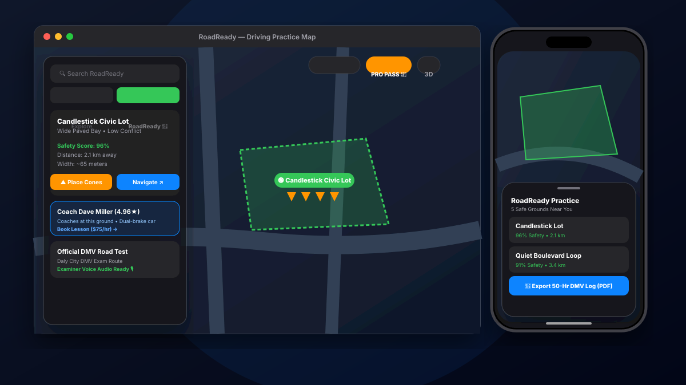

<div align="center">
  
  <h1>RoadReady</h1>
  <p><strong>Safe Driving Grounds & DMV Road Test Preparation Platform</strong></p>
  <p>Dual-Mode Experience: macOS Desktop Floating Interface & iOS Native Mobile Layout</p>

  <p>
    <a href="#-quick-start">Quick Start</a> •
    <a href="#-key-features">Features</a> •
    <a href="#-tech-stack">Tech Stack</a> •
    <a href="#-mobile-support">iOS & Android</a>
  </p>
</div>

---

<div align="center">
  
</div>

---

## 🌟 Overview

**RoadReady** is a modern navigation and driver education platform built to eliminate the fear, anxiety, and expense of learning how to drive. It bridges the gap between first-time ignition and passing the official road test by locating quiet practice grounds, placing virtual cones on pavement, and rehearsing official examiner routes.

---

## ✨ Key Features

### 🖥️ Cupertino-Grade Dual Interface
- **macOS Floating Glass Island:** Translucent frosted materials (`backdrop-blur-xl`), smooth spring physics, and Apple card elevation.
- **iOS 3-Tier Gesture Bottom Sheet:** Interactive Peek, Half, and Full drag states with native rubber-banding.
- **iPhone 16 Pro Frame Simulator:** Built-in mobile chassis with Dynamic Island, Status Bar, and Home Indicator.

### 🔰 Safe Practice Grounds & Navigation
- **Local Practice Ground Discovery:** Dynamically locates spacious parking lots and low-traffic practice routes within 5 km of any GPS coordinate.
- **Virtual Traffic Cone Courses:** Drop parallel parking bays, reverse 90° docking, and slalom drills onto open pavement with zero risk to vehicles.
- **Live Traffic Facility:** Real-time congestion vectors and flow rate status.
- **Dynamic Weather Braking:** Real-time wet asphalt stopping distance telemetry and safety alerts.

### 🎖️ DMV Road Test Simulator
- **Official Examiner Routes:** Turn-by-turn navigation along official DMV test paths.
- **Siri Voice Guidance:** Live spoken examiner instructions and evaluation checkpoints.
- **Road Test Scoring:** Live point-deduction tracking against state passing thresholds.

### 📄 Certified 50-Hour Driving Log (PDF)
- **State Form DL-50HRS Compliant:** Tracks mandatory daytime (40h) and nighttime (10h) practice hours.
- **Printable Export:** 1-tap print and PDF export with supervising driver affidavits and DMV examiner verification stamp box.

### 👨‍🏫 1-on-1 Driving Coach Marketplace
- **Verified Local Instructors:** Connect with certified behind-the-wheel instructors providing dual-control vehicles.
- **3-Step In-App Booking:** Package selection, practice ground meeting location, and instant confirmation voucher.

---

## 🛠️ Tech Stack

- **Frontend:** React 18, Vite 6, Tailwind CSS
- **Map & Spatial Rendering:** MapLibre GL 5 (3D building extrusions & vector layers)
- **Icons:** Lucide React
- **Voice Synthesis:** Web Speech API (`speechSynthesis`)
- **Backend API:** Node.js, Express 5, CORS, File Persistence
- **Native Mobile:** Capacitor 8 (Android & iOS native projects)

---

## 📱 Mobile Support

RoadReady includes native container projects for both iOS and Android powered by Capacitor 8:

```bash
# Sync web build to native shells
npm run cap:build

# Open in Android Studio
npx cap open android

# Open in Xcode (macOS)
npx cap open ios
```

---

## 🚀 Quick Start

```bash
# 1. Clone repository
git clone https://github.com/nipungalhotra/apple-maps-clone.git
cd apple-maps-clone

# 2. Install dependencies
npm install

# 3. Start Frontend & Backend
npm run dev      # Runs Vite on http://127.0.0.1:3000
npm run server   # Runs API on http://127.0.0.1:3001
```

---

<div align="center">
  <sub>Built with precision and care for the next generation of safe, confident drivers.</sub>
</div>
