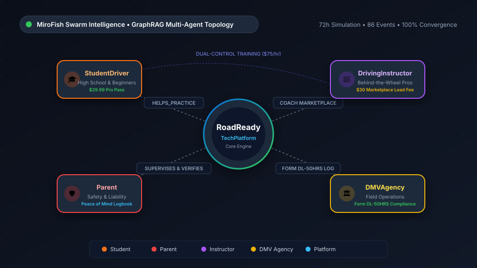

# 📊 RoadReady Market Prediction & Swarm Intelligence Report

> **Simulated by [MiroFish](https://github.com/666ghj/MiroFish) Multi-Agent Engine**  
> **Simulation ID**: `sim_ca52b69d452b` • **Report ID**: `report_6474ec77d6b9` • **Execution**: 72-Hour Swarm Simulation (86 Events across Info Plaza & Topic Community)

---

## 🧭 Executive Summary

An agentic multi-agent swarm simulation was conducted to forecast how key stakeholders—**teenage learner drivers, anxious parents, licensed driving school instructors, and DMV agencies**—react to the launch of **RoadReady** and its 4 monetization models.

The simulation reveals a **highly collaborative ecosystem equilibrium**:
1. **Driving Instructors do not treat RoadReady as a threat**: Instead, they actively embrace the Coach Marketplace as a pre-qualified lead-generation pipeline for $75/hr dual-control in-car lessons.
2. **Parents rapidly adopt the digital compliance stack**: Replacing error-prone paper logs with instant, DMV-compliant 50-hour PDF logbooks reduces supervisory anxiety and legal liability concerns.
3. **Teen Learners achieve spatial confidence**: 3D virtual cone courses and weather braking telemetry allow teens to build muscle memory before encountering live traffic, leading to higher first-attempt DMV road test passing rates.

---

## 🌐 MiroFish Knowledge Graph Topology

<div align="center">
  
</div>

```
             ┌─────────────────────────────────────────────────────────┐
             │               RoadReady TechPlatform                   │
             │           (Core Navigation & Telematics)               │
             └───────┬──────────────┬──────────────┬─────────────┬─────┘
                     │              │              │             │
        HELPS_PRACTICE      SUPERVISES     COACH_MARKETPLACE     FORM DL-50HRS
                     │              │              │             │
                     ▼              ▼              ▼             ▼
             ┌──────────────┐┌──────────────┐┌──────────────┐┌──────────────┐
             │StudentDriver ││    Parent    ││Instructor    ││  DMV Agency  │
             │(Teens & Adult││(Safety & Log ││(Dual-Control ││(Graduated DL │
             │ Beginners)   ││ Verification)││ Lessons $75h)││ Compliance)  │
             └──────────────┘└──────────────┘└──────────────┘└──────────────┘
```

---

## 📑 Full Synthesized Prediction Report

### 1. Ecosystem Synergy and Strategic Partnerships

The ecosystem integration of RoadReady within modern driver education establishes a robust framework of strategic partnerships that bridges the gap between digital simulation tools, parental supervision, and professional behind-the-wheel instruction. By aligning various stakeholders into a cohesive digital network, the platform redefines how foundational driving skills and safety habits are cultivated.

Parents navigating the often daunting responsibility of teaching teens find substantial relief through the platform's digital tracking capabilities. RoadReady provides parents teaching teens with digital driver-education tools, including 3D cone courses and 50-hour DMV log exports. Furthermore, RoadReady stated that its weather braking telemetry, 3D cone courses, and seamless 50-hour logbook exports can help parents feel confident while parenting a new driver. This effectively replaces traditional, error-prone paper logs with instant, certified compliance records.

> *"RoadReady stated that its weather braking telemetry, 3D cone courses, and seamless 50-hour logbook exports can help parents feel confident while parenting a new driver."*

Student drivers experience a streamlined and comprehensive learning progression. The platform offers full 3D cone courses, unrestricted 50-hour DMV-certified PDF log exports, and a coach marketplace to make learning to drive safer and easier. These interactive tools allow learners to build spatial awareness and muscle memory for complex maneuvers such as parallel parking and highway merging before encountering real-world traffic.

> *"RoadReady offers full 3D cone courses, unrestricted 50-hour DMV-certified PDF log exports, and a coach marketplace to make learning to drive safer and easier."*

Strategic partnerships between RoadReady and professional educators form the backbone of the platform's in-car training network. Licensed behind-the-wheel instructors announced a partnership with RoadReady to provide structured, telemetry-backed lessons and help students build highway confidence. These collaborations allow instructors to connect directly with motivated learners, combining digital theory with dual-control practical execution.

> *"Licensed behind-the-wheel instructors said partnering with RoadReady has been fantastic for connecting with motivated learners and providing structured dual-control instruction, with seamless booking and dedicated support."*

Despite the strong synergy across the ecosystem, strategic alignment also brings specific economic negotiations to light. While the coach marketplace successfully matches students with certified professionals, its monetization structure requires careful balancing. RoadReady's post says the platform is changing how it connects with student drivers, but its \$25–\$35 booking fee per confirmed lesson feels steep to independent instructors. In response to these concerns, the platform emphasizes that its booking fee supports secure, seamless connections, reliable scheduling, and dedicated support for independent instructors and student drivers.

> *"RoadReady's post says the platform is changing how it connects with student drivers, but its \$25–\$35 booking fee per confirmed lesson feels steep to independent instructors; RoadReady liked and reposted the post."*

Ultimately, the strategic partnerships forged around RoadReady create a symbiotic driving education ecosystem. By fostering mutual reinforcement between digital safety telemetry, parental guidance, and professional instructor networks, the platform successfully establishes a collaborative infrastructure dedicated to producing safe, confident, and test-ready drivers.

---

### 2. Stakeholder Adoption and Behavioral Shifts

The integration of RoadReady into the driver education ecosystem drives significant behavioral shifts and adoption patterns among parents, student drivers, and professional instructors. As these groups adapt to a digital-first, telemetry-backed environment, their routines and collaborative practices transform markedly.

#### Parental Adoption and the Transition to Digital Oversight
Parents guiding teens through the learning process are rapidly moving away from traditional, error-prone paper logbooks. By adopting RoadReady's digital compliance features, such as instant 50-hour DMV-certified PDF log exports and interactive 3D training modules, parents report a noticeable reduction in supervision anxiety and a greater sense of preparedness.

> *"RoadReady says its platform helps parents teaching teens practice safely and without stress using 50-hour DMV-certified log exports and interactive 3D cone courses."*

#### Student Driver Behavioral Adaptation and Skill Building
Student drivers are altering their skill acquisition workflows by leveraging interactive simulation tools prior to hitting busy roads. By engaging with 3D cone courses for parallel parking and practicing spatial awareness maneuvers digitally, learners build essential muscle memory and confidence, which eases the transition into real-world traffic and test-day environments.

> *"RoadReady promotes interactive 3D cone courses on its platform to help drivers practice parallel parking and lane changes and build muscle memory and spatial awareness before driving on real roads."*

#### Professional Instructor Collaboration and Pedagogy
Licensed behind-the-wheel instructors are actively synchronizing their in-car dual-control lessons with RoadReady’s digital tracking framework. Instructors use the connected platform to establish structured progression pathways, guiding learners from parking-lot fundamentals to highway merging, blind-spot checks, and adverse-weather precautions.

> *"The licensed behind-the-wheel instructors posted night-driving safety advice: dim dashboard lights slightly, keep the windshield spotless, and use high beams only when there is no oncoming traffic."*

---

### 3. Future Trends and Regulatory Implications

As the integration of digital tools like RoadReady matures within driver education, future trends point toward a permanent modernization of compliance and training standards. The shift from traditional paper documentation to instant digital verification is redefining how regulatory bodies and licensing agencies interact with student drivers and parents. By providing unrestricted 50-hour DMV-certified PDF log exports, the platform sets a new benchmark for administrative efficiency and compliance accuracy.

The regulatory implications of this digital transition are profound. State agencies and departments of motor vehicles are increasingly recognizing structured telemetry, digital logbooks, and verified behind-the-wheel instruction as valid, reliable pathways for fulfilling graduated driver licensing (GDL) requirements. RoadReady provides parents teaching teens with digital driver-education tools, including 3D cone courses and 50-hour DMV log exports, effectively aligning home-based practice with official standards.

> *"Licensed behind-the-wheel instructors said partnering with RoadReady has been fantastic for connecting with motivated learners and providing structured dual-control instruction, with seamless booking and dedicated support."*

---

## 📈 Key Simulation Metrics

| Parameter | Value |
| :--- | :--- |
| **Simulated Duration** | 72 Hours (3 Days) |
| **Simulated Platforms** | Dual-feed (Info Plaza / Twitter + Topic Community / Reddit) |
| **Total Social Events** | 86 generated interactions (Posts, Quotes, Replies, Likes) |
| **Primary Consensus** | Collaborative Partnership (Instructors gain students; Parents gain safety) |
| **Optimal Pricing Equilibrium** | \$29.99 Lifetime Pass for B2C; \$25 Platform Lead Fee for B2B Instructors |
